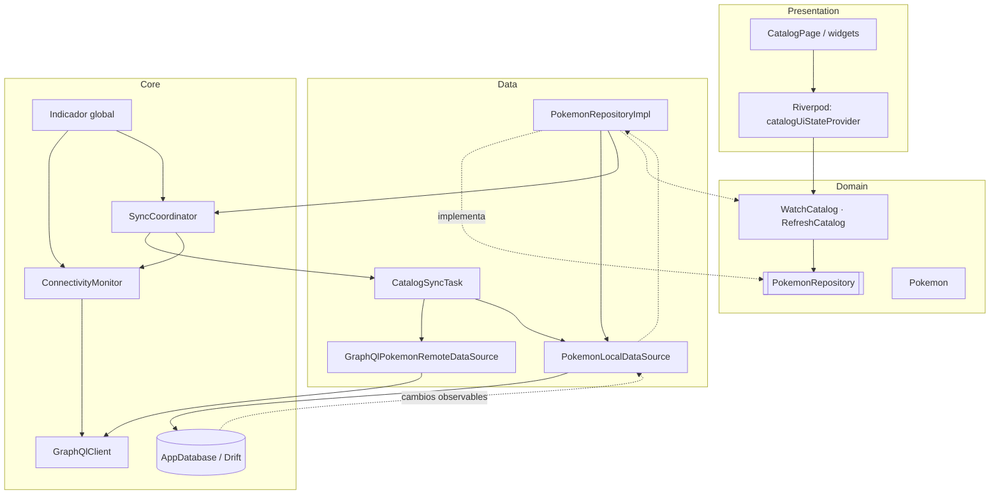

# Arquitectura (ENT-06)

## Capas y dependencias

* **Presentation** no accede al cliente GraphQL ni a Drift.
* **Domain** es Dart puro (entidades, contrato de repositorio, casos de uso, `Failure`).
* **Data** implementa el repositorio, traduce excepciones → `Failure` y no expone DTOs.
* **Core** aloja lo transversal sin lógica de ninguna feature: las features registran sus `SyncTask` en `app/bootstrap.dart`.

## Flujo de lectura (D2)

1. `CatalogPage` observa `catalogUiStateProvider`.
2. Éste combina `watchCatalog()` (Stream Drift), `syncStateProvider` y `availabilityProvider`.
3. Cualquier escritura de `CatalogSyncTask` en la base emite un nuevo valor → la UI se actualiza.
4. La UI jamás espera una respuesta de red.

## Estados (D3)

| Dimensión | Estados | Dueño |
|---|---|---|
| Disponibilidad | `verifying · online · offline · serviceUnavailable` | `ConnectivityMonitor` |
| Sincronización | `idle · syncing · waitingRetry · failed` | `SyncCoordinator` |

El indicador compone ambas más el origen/vigencia de los datos; `offline` y `serviceUnavailable` prevalecen sobre `syncing` para no mostrar estados contradictorios.

## Inyección de dependencias

Riverpod. Todo es sustituible con `ProviderScope(overrides: ...)`: `appDatabaseProvider` (base en memoria en pruebas), `graphQlClientProvider`, `pokemonRemoteDataSourceProvider`, `syncTasksProvider`…
