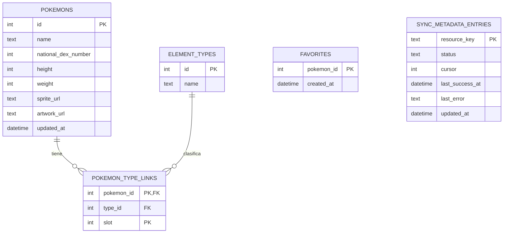

# Modelo de datos local (ENT-07, PS-01)

`FAVORITES` **no tiene clave foránea** al catálogo y `SYNC_METADATA_ENTRIES` es independiente: ninguna operación de sincronización del catálogo puede tocarlas (PS-11, OF-21).

## Claves e índices

| Tabla | Clave | Índices | Uso |
|---|---|---|---|
| `pokemons` | `id` (id de PokeAPI) | `idx_pokemons_name`, `idx_pokemons_dex` | orden del catálogo; búsqueda por nombre (final) |
| `element_types` | `id` | — | tipos |
| `pokemon_type_links` | (`pokemon_id`, `slot`) | `idx_pokemon_type_links_type` | JOIN del catálogo y filtro por tipo (final) |
| `favorites` | `pokemon_id` | — | favoritos |
| `sync_metadata_entries` | `resource_key` | — | cursor, estado, última sync |

## Relación con el Diagrama 6

Implementadas: `POKEMON`, `TYPE`, `POKEMON_TYPE`, `FAVORITE`, `SYNC_METADATA`. Pendientes para la entrega final: `ABILITY`, `POKEMON_ABILITY`, `MOVE`, `POKEMON_MOVE`, `EVOLUTION`, `TRIVIA_RESULT`, `TRIVIA_ANSWER`. Cada una se añade con `schemaVersion + 1` y un paso `onUpgrade`.

## Escrituras

`PokemonLocalDataSource.savePage` ejecuta en **una transacción**: upsert de Pokémon y tipos, reemplazo de relaciones de los Pokémon de la página y actualización del cursor. Una interrupción deja el estado anterior intacto (RNF-RES-04).
