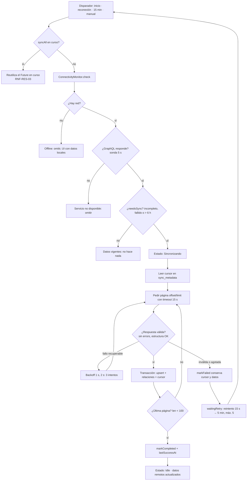

# Flujo de sincronización implementado (ENT-08)

## Garantías

| Garantía | Mecanismo |
|---|---|
| UI nunca bloqueada | Todo asíncrono; Drift en isolate; JSON decodificado con `Isolate.run`. |
| Sin duplicados (PA-13) | Upsert por PK + un único sync en vuelo. |
| Sin datos parciales (PA-09) | Página + cursor en una transacción. |
| Reanudación | `status ≠ completed` ⇒ continuar en `cursor`. |
| Remoto prevalece (OF-19) | El upsert sobrescribe todos los campos del catálogo. |
| Datos locales a salvo (OF-04) | Una respuesta con errores/parcial se descarta antes de escribir. |
| Reintentos acotados (RNF-RES-02) | `RetryPolicy` por página + límite de reintentos automáticos en el coordinador. |
